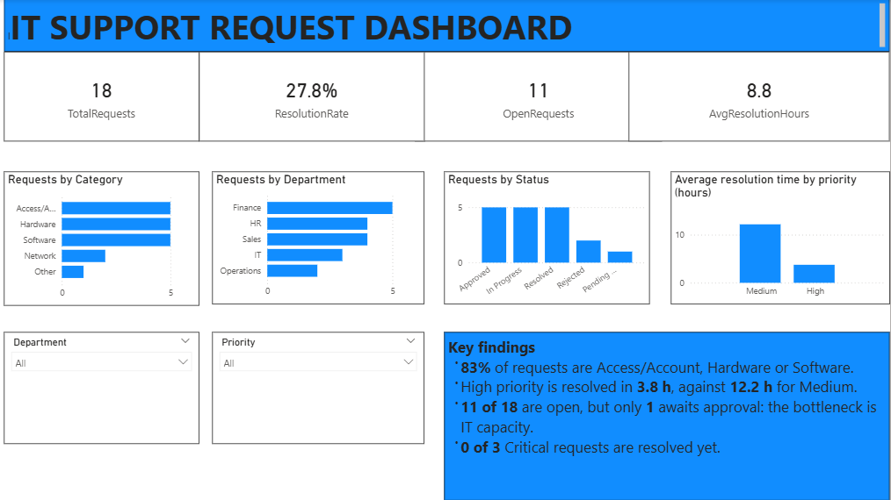

# IT Request System (Microsoft Power Platform)

An end-to-end IT helpdesk workflow built with low-code Microsoft 365 tools and no admin rights:
staff submit requests in an app, high-priority requests go through an approval step,
the requester is emailed the outcome, and a Power BI report tracks the workload.



| Layer | Tool | What it does |
|---|---|---|
| Data | Microsoft Lists | Stores every request (title, category, priority, status, requester, approval comments, resolution time) |
| Front end | Power Apps (canvas) | Staff browse and submit their own requests; system fields are locked |
| Workflow | Power Automate | Routes High/Critical requests to approval, writes the decision back, emails the requester |
| Reporting | Power BI | Measures resolution rate, open workload, priority mix and resolution time |

## Repository contents

| Folder | Contents |
|---|---|
| [1-microsoft-list](1-microsoft-list) | Screenshots: all requests; one approved request |
| [2-power-apps](2-power-apps) | Screenshots: browse screen; new request form |
| [3-power-automate](3-power-automate) | Screenshots: flow design; run history; approved run; approval email |
| [4-power-bi](4-power-bi) | `dax-measures.dax`; screenshots: measures, dashboard, filtered dashboard |

The solution files (.msapp, flow package, .pbix) are kept private because they contain
my organisation's SharePoint address and account details. The formulas and logic are
documented below so the build can be reproduced.

## 1. Microsoft List: the data store

A list called **IT Request** with these columns:

| Column | Type | Why |
|---|---|---|
| Request Title | Single line of text | Short summary of the problem |
| Description | Multiple lines of text | Details for the technician |
| Category | Choice (required): Hardware, Software, Network, Access/Account, Other | Groups the workload |
| Priority | Choice (required): Low, Medium, High, Critical | Decides whether approval is needed |
| Status | Choice: New, Pending Approval, Approved, In Progress, Resolved, Rejected | Tracks progress; set by the flow, not the user |
| Department | Choice | Shows where requests come from |
| Requester | Person | Who raised the request |
| Approver comments | Multiple lines of text | Written back by the flow after approval |
| Resolved Date / Resolution Hours | Date / Number | Used for the resolution-time measure |


## 2. Power Apps: the request app

Built from the list (single-screen responsive template) and then adjusted:

- **Staff see only their own requests**, newest first, with a search box:
  ```
  SortByColumns(
      Filter('IT Request', Requester.Email = User().Email, StartsWith(Title, SearchInput1.Text)),
      "Created", SortOrder.Descending)
  ```
- **System fields are read-only** (Status, Requester, Approver comments, Resolved Date, Resolution Hours): `DisplayMode.View`
- **Confirmation on save:** `Notify("Request submitted", NotificationType.Success)`


## 3. Power Automate: the approval flow

Trigger: **When an item is created** in the list.

```
If Priority is High OR Critical
    Update item -> Status = Pending Approval
    Start and wait for an approval (Approve/Reject; in this lab I acted as the approver)
    If Approved -> Status = In Progress, save approver comments, email requester
    If Rejected -> Status = Rejected, save approver comments, email requester
Else (Low / Medium)
    Update item -> Status = New (goes straight to the IT queue)
```


## 4. Power BI: the report

Connected with the SharePoint Online list connector. Measures (see [dax-measures.dax](4-power-bi/dax-measures.dax)):

```
TotalRequests      = COUNTROWS('IT Request')
ResolvedRequests   = CALCULATE([TotalRequests], 'IT Request'[Status] = "Resolved")
OpenRequests       = CALCULATE([TotalRequests], NOT 'IT Request'[Status] IN {"Resolved", "Rejected"})
ResolutionRate     = DIVIDE([ResolvedRequests], [TotalRequests])
AvgResolutionHours = AVERAGE('IT Request'[Resolution Hours])
HighPriorityShare  = DIVIDE(CALCULATE([TotalRequests], 'IT Request'[Priority] IN {"High", "Critical"}), [TotalRequests])
```

**What the report shows (sample data, snapshot of 18 requests, November 2026):**
- 83% of requests are Access/Account, Hardware or Software.
- High-priority requests were resolved in 3.8 h on average, against 12.2 h for Medium.
- 11 of 18 requests were open but only 1 was awaiting approval, which would point to IT capacity, not approvals, as the bottleneck.
- None of the 3 Critical requests had been resolved.


## Problems I solved

| Problem | Cause | Fix |
|---|---|---|
| No permission to create a SharePoint site or Team | Student account without admin rights | Used **My lists** on OneDrive and pointed the flow at the personal site address |
| Update item overwrote Priority, Title and Requester | Update item sends defaults for fields left empty | Mapped every required field to the trigger's value |
| Email step failed with an array error | Values from inside "Apply to each" are arrays | Used `triggerOutputs()?['body/Title']` instead |
| DAX "column not found" | Hidden trailing space in the column name (`Resolution Hours `) | Renamed the column in the list |
| Requester column showed Error in Power BI | A Person column is a record and cannot be cast to text | Removed (or expanded) the column in Power Query |
| Statuses changed while entering sample data | The flow ran on every new row | Turned the flow off during bulk entry, cancelled stuck runs |

## Notes

- All data is **sample data** created for this lab; no real users or requests.
- Email addresses and account names have been removed from the screenshots.

## Skills shown

Microsoft Lists data modelling, Power Fx, Power Automate approvals and conditions,
Power Query, DAX, Power BI report design, troubleshooting.
